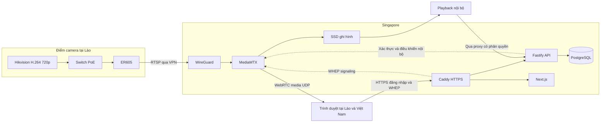

# Kế hoạch triển khai DEV.ONE Secure Live: mục tiêu độ trễ 0,5-1 giây

Ngày lập: 30/10/2026. Trạng thái: kế hoạch kỹ thuật, chưa triển khai và chưa có benchmark thiết bị thật.

## 1. Kết luận và phạm vi đã chốt

Giữ đường phát chính trong blueprint: camera Hikvision tại Lào → switch PoE → ER605 → WireGuard → MediaMTX tại Singapore → trình duyệt WebRTC. Không cần Mini PC tại Lào trong thiết kế này. Mục tiêu 0,5-1 giây là mục tiêu kỹ thuật cần chứng minh, chưa phải SLA có thể cam kết trên mọi mạng.

Người dùng đã chốt: **720p, chưa cần âm thanh, người xem ở cả Lào và Việt Nam**. Địa điểm và nhà mạng camera tại Lào chưa xác định. Ưu tiên độ trễ thấp, nhưng vẫn phải bảo đảm hình ảnh sử dụng được và không đánh đổi bằng đứng hình thường xuyên.

Kế hoạch áp dụng cho một camera, tối đa 200 phiên live, web riêng tư, phân quyền, quản trị người dùng, ghi hình trên server và xem lại. Giữ nguyên các loại trừ v1 của PDF: không mobile app riêng, multi-camera, chat, thanh toán, AI, DRM, Kubernetes hoặc NUC/Edge Agent.

Đã đọc toàn bộ 14 trang PDF đầu vào, đối chiếu hình render các trang và tài liệu chính thức liên quan. Tại thời điểm khảo sát, thư mục `/Volumes/Developer/Projects/camera` chỉ có PDF và `.DS_Store`; chưa có Git repository, source, tests, manifest hay CI để kiểm tra. `.DS_Store` không thuộc nội dung cần đọc. Không có kết quả chạy camera, router, VPS hoặc trình duyệt thực tế trong báo cáo này.

Tài liệu nguồn: [Blueprint v1.0](/Volumes/Developer/Projects/camera/DEVONE_Secure_Live_Codex_Blueprint_Ban_Moi_20261030.pdf), đặc biệt trang 2-7 về kiến trúc/thiết bị, trang 8-9 về ứng dụng, trang 10-13 về tải và nghiệm thu. Yêu cầu mới 0,5-1 giây thay thế mục tiêu thiết kế 1-2 giây trong PDF.

## 2. Định nghĩa thành công

"Độ trễ" ở đây là **glass-to-glass**: thời gian từ sự kiện xuất hiện trước ống kính đến khi hình của sự kiện hiện trên màn hình người xem. Không dùng ping, thời gian API, ICE connected hoặc thời gian giải mã làm số đo thay thế.

Các ngưỡng dưới đây là đề xuất nghiệm thu cần xác nhận bằng POC; không phải số đã đo:

| Chỉ số | Mục tiêu | Cách đánh giá |
|---|---|---|
| Độ trễ live p95 | ≤ 1.000 ms | Riêng từng nhóm quốc gia/nhà mạng/thiết bị/đường ICE đã xác định |
| Độ trễ live p50 | Hướng tới ≤ 500 ms | Tiếp tục tối ưu nếu còn dư địa; nhanh hơn 500 ms vẫn tốt |
| Thời gian có khung hình đầu tiên | p95 ≤ 2 giây | Từ lúc người dùng bấm xem đến khung hình chuyển động đầu tiên, khi nguồn đã online |
| Thời gian đứng hình | ≤ 1% thời gian quan sát | Báo riêng thời gian offline, phiên lỗi và mất hình; không loại âm thầm |
| Thu hồi quyền phiên đang xem | ≤ 5 giây khi hệ thống khỏe | Xác nhận media thực sự dừng, không chỉ thay trạng thái UI |
| Tải | 200 phiên WebRTC thực trong 8 giờ | Có recording và tải playback được khai báo; không OOM/restart ngoài dự kiến |
| Tự phục hồi sau WAN mất 60 giây | Hướng tới ≤ 30 giây sau khi WAN sử dụng được | Đo riêng với độ trễ live; không tính 60 giây mất mạng là độ trễ frame |

Đo p50/p95/p99 và max, cả toàn bài thử lẫn từng cửa sổ 5 phút. Giai đoạn startup báo riêng; mọi khoảng treo hoặc mất nguồn trong thời gian chạy phải xuất hiện trong số liệu chất lượng. Không gộp kết quả Việt Nam tốt với Lào kém thành một p95 đẹp. UDP trực tiếp và TURN phải có kết quả riêng; mạng cần TURN không tự động được tính là đạt dưới 1 giây.

Nếu LAN đã chậm hoặc đường quốc tế không đáp ứng, phải báo **chưa đạt mục tiêu** và xử lý đúng chặng. Không âm thầm nâng ngưỡng lên 1-2 giây để đóng mốc.

## 3. Kiến trúc và bản đồ dự án dự kiến

Media live đi từ MediaMTX tới trình duyệt; Fastify/Next.js không nhận rồi chuyển tiếp từng frame live. Caddy xử lý HTTPS/signaling; UDP media là đường riêng. Recording là nhánh song song, không nằm giữa nguồn và người xem.

| Thành phần | Trách nhiệm và ranh giới |
|---|---|
| Camera | Capture/encode H.264 một lần; tài khoản RTSP riêng, không public WAN |
| ER605 + WireGuard | Đưa một nguồn camera sang server; không chở 200 luồng người xem qua uplink Lào |
| MediaMTX | Kéo nguồn liên tục, phân phối media, ghi hình; API điều khiển chỉ private |
| Fastify | Login, RBAC, quota phiên, callback auth, kick, recording desired state, playback proxy, audit |
| Next.js | Player, trạng thái kết nối, quản trị và danh sách bản ghi; không chứa secret thiết bị |
| PostgreSQL | Người dùng/quyền/phiên/record settings/audit; khóa giao dịch khi cấp suất xem |
| Caddy | TLS, routes, headers; bảo toàn WHEP session URL và các HTTP method cần thiết |
| Monitoring | Số phiên media thực, nguồn offline, packet loss, CPU/RAM/network/disk; endpoint nội bộ |

Cấu trúc code dự kiến theo PDF: `apps/web`, `apps/api`, `packages/shared`, `infra/mediamtx`, `infra/vpn`, `infra/docker`, `infra/proxy`, `tests/api`, `tests/e2e`, `tests/load-webrtc`, `docs`. Entry point thực tế và lệnh kiểm thử sẽ được ghi sau khi tạo scaffold; hiện chưa có để khẳng định.

## 4. Những điều cần điều chỉnh hoặc làm rõ trong blueprint

| Nội dung | Cách xử lý trong kế hoạch mới |
|---|---|
| Mục tiêu 1-2 giây | Thay bằng p95 ≤ 1 giây; thêm cổng kiểm thử trước phát triển đầy đủ website |
| RTSP/TCP làm mặc định | Giữ làm baseline ổn định; A/B với RTP/UDP trong VPN, không mặc định UDP luôn tốt hơn |
| GOP 0,5-1 giây | Đo startup/phục hồi và bitrate burst; GOP không bằng độ trễ ổn định của cả pipeline |
| Source 102 | Thử trước nhưng xác minh độ phân giải/profile bằng luồng thật; không chỉ nhìn menu |
| Chọn Singapore | Điểm thử ưu tiên theo PDF, chưa phải kết luận đường mạng tối ưu cho cả hai quốc gia |
| Token ngắn hạn | Tách hạn tạo kết nối và vòng đời kết nối; phải thử cơ chế hết hạn/kick thật |
| Ghi 24h và giữ 24h | Hai tham số độc lập; chưa được mặc định xóa sau một ngày khi khách chưa chốt |
| White-label | Không lộ thông tin kỹ thuật trong UI; không suy ra media origin IP tự được ẩn |
| Đo tại Việt Nam rồi mang sang Lào | Kết quả trước vận chuyển chỉ là lab; phải lặp lại benchmark trên uplink Lào |

Datasheet hãng cho họ DS-2CD2643G2-LIZS2U có 720p/25 fps trên sub-stream và H.264 Baseline. Đây là căn cứ để chọn POC, không xác nhận suffix/firmware của thiết bị đang sở hữu. [Datasheet Hikvision](https://www.hikvision.com/content/dam/hikvision/products/S000000001/S000000002/S000000003/S000000025/OFR007888/M000117797/Data_Sheet/DS-2CD2643G2-LIZS2U_Datasheet_20240704.pdf)

## 5. Ngân sách độ trễ và cách tối ưu

Bảng sau là **phân bổ thiết kế do đề xuất**, không phải benchmark hoặc thông số nhà sản xuất. Dùng để phát hiện chặng vượt ngân sách. Không cộng p95 từng chặng rồi coi là p95 end-to-end.

| Chặng | Ngân sách làm việc |
|---|---:|
| Phơi sáng, xử lý ảnh, encode trong camera | 80-200 ms |
| LAN, VPN và uplink camera → Singapore | 40-140 ms |
| Nhận/repacketize/fan-out tại media server | 10-50 ms |
| Singapore → mạng người xem | 30-120 ms |
| Jitter buffer, decode và hiển thị | 100-250 ms |
| Tổng khoảng thiết kế | 260-760 ms |
| Phần dư tới 1 giây ở đầu trên | 240 ms |

Nếu camera riêng đã tốn vài trăm mili giây quá ngân sách, nâng CPU VPS không giải quyết được. Cần đo cả ban ngày và ban đêm: exposure dài, giảm fps hoặc xử lý ảnh nhiều có thể làm kết quả khác nhau.

### 5.1 Camera: baseline và ma trận A/B

Baseline đề xuất: H.264 thường, 1280×720, 25 fps, không audio, profile Baseline nếu có, không B-frame, bitrate ban đầu 1,5 Mbps, GOP 25 frame. Tắt H.264+/H.265+ trong profile POC nếu đang bật; lưu cấu hình gốc trước thay đổi. MediaMTX nêu rõ H.264 chứa B-frame gây vấn đề với WebRTC trình duyệt. [Codec WebRTC](https://mediamtx.org/docs/features/webrtc-specific-features)

Thay từng biến, không thay đồng loạt:

| Biến | Các giá trị thử | Quyết định dựa trên |
|---|---|---|
| GOP | 25 frame (1s), 12 hoặc 13 frame (~0,5s ở 25 fps) | Startup, thời gian hết lỗi hình, keyframe burst |
| Bitrate | 1,0 / 1,5 / 2,0 Mbps | Chi tiết chuyển động, p95, packet loss, tải uplink |
| Rate control | CBR trước, đối chứng VBR giới hạn nếu firmware cho phép | Bitrate đỉnh và hàng đợi khi cảnh chuyển động |
| Stream | 102 trước; 101 cùng độ phân giải nếu cần | B-frame, decoder compatibility, độ trễ thực |
| Xử lý hình ảnh | Profile hiện tại so với giảm xử lý không cần thiết | Chất lượng và latency cả sáng/tối |

Kiểm tra ít nhất 60 giây frame thực, không chỉ `has_b_frames` của metadata; đếm keyframe interval và phân bố frame types. Đo cảnh có chuyển động, không chỉ camera nhìn tường. Không bắt buộc hạ chất lượng đến mức không sử dụng được để đạt số đẹp.

Giữ video không tái mã hóa trong đường phát chính nếu tương thích. Nếu không thể tạo H.264 phù hợp sau khi thử cấu hình, lập phương án riêng cho transcoder trên server và đo lại toàn tuyến; không tự đưa Mini PC vào Lào. Hiện chưa có nhu cầu audio. Nếu bổ sung sau này, cần test lại live, đồng bộ hình/tiếng và playback; G.711 không mặc nhiên đòi transcoder vì MediaMTX hỗ trợ G.711 trên WebRTC. [Codec đầu đọc](https://mediamtx.org/docs/read/webrtc)

### 5.2 Mạng: chọn đường ít đệm nhưng ổn định

1. Xác minh nguồn PoE, LAN, tốc độ link và packet drops trước tối ưu phần mềm.
2. ER605 chủ động tạo tunnel ra VPS; cấu hình keepalive phù hợp ở phía sau NAT. Không mở RTSP hay trang quản trị camera ra Internet.
3. Mục tiêu uplink đề xuất là có dư địa ít nhất khoảng 3 lần bitrate đỉnh đo được trong giờ cao điểm. Ví dụ luồng có đỉnh 2 Mbps cần thử đường còn tối thiểu khoảng 6 Mbps sử dụng được; speedtest đơn lẻ chưa đủ.
4. Đo RTT, loss, jitter và tải nền ở giờ thường/cao điểm. Traceroute chỉ hỗ trợ chẩn đoán; không kết luận mất media chỉ vì router trung gian không trả ICMP.
5. A/B RTSP interleaved TCP với RTP/UDP qua WireGuard: TCP có thể tích lũy trễ khi retransmit; UDP có thể giảm chờ nhưng lỗi frame khi mất gói. Chọn phương án đạt đồng thời latency và freeze. RTSP signaling vẫn dùng TCP khi media dùng UDP. [RTSP transport](https://mediamtx.org/docs/features/rtsp-specific-features)
6. Với UDP, kiểm tra cả RTP/RTCP và return route/ACL trong tunnel. Không dùng việc mở được TCP 554 để kết luận UDP media đã đi được.
7. Đo path MTU/fragmentation trước đổi MTU hoặc UDP payload; không sao chép một giá trị cho mọi WAN. Chỉ chỉnh queue/buffer khi thấy drops hoặc backlog bằng số liệu.
8. Singapore là baseline. Nếu chặng quốc tế vượt ngân sách, đề xuất thử thêm nhà cung cấp Singapore hoặc vị trí gần khác; việc thuê/chuyển cần chốt chi phí và phạm vi. Chọn bằng kết quả từ cả Lào lẫn Việt Nam.

Đối với ER605 standalone, diễn đàn hỗ trợ ghi nhận giới hạn nhiều subnet Allowed IPs tháng 03/2026. Không suy ra firmware hiện tại vẫn hệt như vậy, cũng không giả định đã sửa. Bắt đầu với một peer và luồng server-originated; xác minh source address/return route. Nếu cần SNAT, giới hạn đúng traffic tới camera và ghi lại tác động audit. Không quảng bá `0.0.0.0/0` chỉ để làm tunnel chạy. [Hướng dẫn WireGuard](https://support.omadanetworks.com/en/document/13120/) · [Ghi nhận giới hạn ER605](https://community.tp-link.com/en/business/forum/topic/859636)

### 5.3 Media server và player

- Duy trì một nguồn RTSP luôn sẵn sàng để không phải mở camera cho mỗi người xem, và recording vẫn hoạt động khi không ai xem.
- Ưu tiên WebRTC media UDP trực tiếp. Chỉ bật TCP/TURN fallback sau kiểm thử mạng bị chặn; đo riêng đường relay. Không chuyển sang HLS mà vẫn hiển thị như đã đạt chế độ dưới 1 giây. [Kết nối WebRTC](https://mediamtx.org/docs/features/webrtc-specific-features)
- Chọn đúng public candidate, tránh quảng bá LAN/WireGuard IP không cần thiết. Origin IP của media có thể thấy bởi viewer khi kết nối trực tiếp; muốn giấu phải có thiết kế relay riêng và đo lại.
- Không thêm video transcoding per-viewer. Một nguồn cố định cũng không tạo ra adaptive bitrate cho từng người xem; v1 cần profile phù hợp mạng mục tiêu. Nếu muốn nhiều mức chất lượng, đó là quyết định mở rộng sau POC.
- Player dùng `RTCPeerConnection` + WHEP, một phiên cho mỗi player; đóng phiên cũ khi chuyển trang/reconnect, cleanup session trên server, không mở nhiều peer chồng lên nhau.
- Có trạng thái connecting/live/reconnecting/offline/denied; `playsInline`, thử autoplay video không audio; giới hạn retry và dùng backoff có jitter.
- Khi tab quay lại foreground hoặc media ngừng tiến triển, kiểm tra frame/stats rồi phục hồi có giới hạn. Không reconnect liên tục để che latency xấu.
- Không đặt jitter buffer bằng 0 hoặc dùng API thử nghiệm như điều kiện bắt buộc cross-browser. Chỉ thử tuning có feature detection và số đo trước/sau.
- Thu `getStats()` mỗi 2 giây: RTT, loss, jitter, frame decoded/dropped, freeze, bytesReceived, selected ICE pair và buffer delay. Dùng sai phân `jitterBufferDelay / jitterBufferEmittedCount` giữa hai mẫu; đây chỉ là thời gian trong buffer, không phải glass-to-glass. [W3C WebRTC stats](https://www.w3.org/TR/webrtc-stats/)

## 6. Hạ tầng và chi phí theo tải

Đề xuất khởi điểm cho benchmark theo PDF: media node 8 vCPU, 16 GB RAM, NIC public 1 Gbps, SSD bền vững; app/API/DB có thể thử trên node riêng 2 vCPU/4 GB hoặc cùng máy nếu ngân sách chỉ cho POC. Đây là cấu hình để đo, chưa chứng minh đủ 200 người. Tách dịch vụ/volume ngay từ đầu; không thêm cluster/Kubernetes.

Tính theo bitrate video mỗi viewer, 200 viewer, overhead dự phòng 15%, đơn vị GB/TB thập phân:

| Video | Egress đồng thời | 8h/ngày, 30 ngày | 24h/ngày, 30 ngày | Ghi hình 24h/ngày, một nguồn |
|---|---:|---:|---:|---:|
| 1 Mbps | 230 Mbps | 24,84 TB | 74,52 TB | 10,8 GB/ngày |
| 1,5 Mbps | 345 Mbps | 37,26 TB | 111,78 TB | 16,2 GB/ngày |
| 2 Mbps | 460 Mbps | 49,68 TB | 149,04 TB | 21,6 GB/ngày |

Công thức: `egress Mbps = bitrate × số viewer × 1,15`; `GB ghi/ngày = bitrate Mbps × 10,8` khi ghi đủ 24 giờ. Egress trên giả định 200 người duy trì toàn thời gian nêu trong bảng, không phải dự báo usage thực tế. Loss/retransmission, TURN, playback, tải file và backup cần tính riêng; 15% không phải trần.

Ví dụ profile 1,5 Mbps: giữ 7 ngày cần 113,4 GB video thô; 30 ngày cần 486 GB. Để trống 20%, phần dung lượng dành cho video phải ít nhất `dữ liệu / 0,8`, rồi cộng OS/DB/logs và biến động bitrate. Chưa chốt retention nên chưa chọn ổ cuối cùng và chưa bật xóa tự động dữ liệu thật.

Điều kiện chọn nhà cung cấp: sustained throughput, quota/phí vượt egress, peering tới Lào và Việt Nam, bảo vệ UDP, I/O SSD, snapshot/backup và khả năng truy cập UDP. Không chọn gói chỉ vì nhiều vCPU. Giá thuê cụ thể cần báo giá tại thời điểm chọn; phí phần mềm 50 triệu trong PDF không chứng minh đã bao gồm traffic.

Public cần thiết theo cấu hình đã pin: HTTPS 443/TCP, WebRTC UDP, WireGuard UDP; port điều khiển/metrics/playback/DB private, SSH giới hạn nguồn hoặc qua VPN. TURN có listener và dải relay riêng; TURNS 443 cần tránh xung đột với HTTPS bằng IP/host phù hợp. Không giả định reverse proxy HTTP chuyển tiếp được UDP.

## 7. Kế hoạch theo mốc và cổng quyết định

Ước lượng dưới đây là ngày làm việc kỹ thuật, chưa gồm thời gian chờ thiết bị, VPS, đi lại, nhà mạng và phê duyệt chi phí. Không phải cam kết lịch. Tổng phần chính khoảng **18-29 ngày làm việc**, cộng khoảng 3-5 ngày dự phòng nếu phải xử lý mạng/codec.

| Mốc | Công việc cụ thể | Bằng chứng đầu ra và điều kiện qua mốc | Ước lượng |
|---|---|---|---:|
| M0: Kiểm kê và khóa thiết kế POC | Xác minh đúng suffix camera, ER605 UN/2.30/firmware, PoE, IP, nguồn điện; thống nhất profile 720p không audio; backup cấu hình; tạo repo và test plan khi bắt đầu triển khai | Device inventory, sơ đồ kết nối, bản backup bảo mật, danh sách version và secrets policy; đủ thiết bị/access để thử | 0,5-1 ngày |
| M1: LAN và sàn độ trễ | Probe 101/102; xác thực H.264/no B-frame/fps/GOP; MediaMTX + player POC; đo quang học LAN, thử sáng/tối, 60 phút/profile cuối | Video đo gốc, CSV, cấu hình đã ẩn secrets; trình duyệt thật có hình. Hướng tới LAN p95 ≤ 400 ms để còn dư ngân sách WAN | 1-2 ngày |
| M2: Singapore và VPN | VPS test, tunnel ER605, route/ACL/source IP, RTSP thật; A/B TCP/UDP; restart thiết bị và WAN flap 60s, lặp 3 lần có giám sát | VPS nhận video liên tục ≥ 2h, tự nối lại, không public camera; backup cấu hình đã kiểm chứng | 1-2 ngày |
| M3: Chứng minh dưới 1 giây | Player tối thiểu trên HTTPS, 1/20 peer; ma trận bitrate/GOP/transport; Chrome/Safari/Android/iOS thật; test mạng Việt Nam và Lào nếu đã có | Báo cáo p50/p95/p99, startup/freeze; profile thắng và nguyên nhân chọn. Chưa có mạng Lào thì chỉ đạt lab, giữ gate thực địa mở | 2-3 ngày |
| M4A: Nền ứng dụng và bảo mật phiên | Shared schemas, Fastify, PostgreSQL, Next.js; login/logout, Argon2id, MFA admin, RBAC, quota 200, auth callback, mapping/kick/reconcile | API/DB concurrency tests và E2E; không có đường WHEP/playback bypass; phiên 201 bị chặn, revoke cắt media | 4-6 ngày |
| M4B: Recording và quản trị | Bật/tắt ghi idempotent, desired/observed state, reconcile sau reboot, danh sách timespan, quyền xem lại/tải, retention, audit, white-label | File ghi thật phát được, tắt ghi không dừng live, reboot khôi phục trạng thái, test disk/retention/backup | 3-5 ngày |
| M5: Tải và nghiệm thu kỹ thuật | Ramp 1/20/50/100/150/200; burst joins; soak 8h; playback đồng thời; lỗi mạng và revoke | 200 phiên media thật; metrics/load-generator evidence; latency/freeze còn đạt; capacity và egress report | 3-5 ngày |
| M6: Cutover Lào và bàn giao | Người tại chỗ nối WAN/PoE; kiểm tra tunnel, live/record/playback; lặp test hai quốc gia giờ cao điểm; diễn tập restore/rollback | Biên bản mạng Lào thật, matrix thiết bị/mạng đạt và chưa đạt, runbook, backup đã thử restore | 3-5 ngày |

Đường găng: M0 → M1 → M2 → M3 → M4 → M5 → M6. Có thể soạn DTO/test cases trong lúc chờ POC, nhưng không xây website production đầy đủ khi chưa chứng minh được camera → server. M3 là cổng mới quan trọng nhất cho yêu cầu dưới 1 giây.

Nếu camera chưa ở Lào, M2/M3 chạy qua WAN Việt Nam chỉ chứng minh cấu hình và khả năng vận hành. M6 phải lặp lại phần mạng/latency/load với uplink thực tế; không ký đạt Lào dựa vào lab tại Việt Nam.

Khi chuyển sang triển khai, ưu tiên gói đầu **M0-M2 + đo baseline M1**, đúng tinh thần prompt trang 14. Codex giữ discovery, thiết kế, review, verification và nghiệm thu UI; phần code dùng quy trình Antigravity đã được người dùng cho phép, worktree riêng và task packet bất biến. Chọn model theo quy tắc hiện hành tại thời điểm chạy, kiểm catalog/quota trước; không khởi chạy worker trong công việc lập kế hoạch này.

## 8. Thiết kế phần mềm cần khóa trước khi code

### 8.1 Phiên xem và quyền

- Cookie web HttpOnly/Secure, CSRF cho thao tác thay đổi trạng thái, kiểm input và rate limit; admin có MFA; role không tự thay thế permission live/playback/download.
- `POST /api/streams/live/session` kiểm quyền và cấp suất bằng giao dịch PostgreSQL. Trạng thái đề xuất: reserved → connected → closing → closed; reservation lỗi/hết hạn phải giải phóng.
- Giới hạn 200 tính cả suất đang reserve để không vượt khi nhiều người bấm cùng lúc. Mỗi suất liên kết tối đa một phiên media; không để reuse token tạo nhiều kết nối ngoài quota.
- Token tạo phiên ngắn hạn, bind stream/user/session và action; kiểm trong callback nội bộ. Không đưa token vào query/log nếu có thể gửi Authorization header.
- Map viewer session ↔ MediaMTX session ID; xác minh tính ổn định của ID/callback/API bằng integration spike trước chọn schema cuối. Cleanup callback phải idempotent; heartbeat trình duyệt không phải bằng chứng duy nhất của phiên media.
- Disable/logout/kick phải đóng peer thực ở media server và chặn lần tạo tiếp theo. Retry/reconcile khi Control API lỗi, đồng thời báo trạng thái pending; không báo revoke thành công trước khi có bằng chứng.
- Tài liệu MediaMTX hiện mô tả HTTP auth `expireAt` có thể đóng phiên khi hết hạn. Phải kiểm trên version đã pin; không coi TTL token tự động tương đương TTL media. Chọn thời hạn media riêng, kiểm ảnh hưởng reconnect do expiry tới freeze. [MediaMTX authentication](https://mediamtx.org/docs/features/authentication)
- Backend/auth unavailable: từ chối phiên mới; thử và ghi rõ chính sách phiên cũ đến hạn. Không vô tình bật anonymous đọc live khi auth lỗi.

### 8.2 Recording và playback

- DB giữ trạng thái mong muốn; API áp thay đổi, đọc lại trạng thái quan sát và ghi audit. API timeout/crash giữa chừng phải được reconciler sửa, UI phân biệt pending/applied/failed.
- Ghi fMP4 cùng nguồn 720p; volume bền vững. `recordPartDuration` và độ dài segment là thông số ghi đĩa, không phải buffer bắt buộc của live. Khi crash có thể mất phần cuối chưa được hoàn tất. [MediaMTX recording](https://mediamtx.org/docs/features/record)
- Retention là quyết định riêng với số giờ ghi mỗi ngày. Test cleanup trên dữ liệu thử; không xóa bản ghi đang hoạt động; làm rõ độ trễ xóa do ranh giới segment/lịch cleanup và kiểm chính sách thực tế.
- Playback API lấy timespan nội bộ, kiểm quyền, giới hạn khoảng thời gian và truyền streaming có backpressure; không buffer cả file vào RAM. Thử seek/range/cancel và quyền download trên trình duyệt mục tiêu. MediaMTX có API `/list` và `/get` cho bản ghi. [Playback](https://mediamtx.org/docs/features/playback)
- Lưu UTC trong DB, hiển thị Asia/Vientiane; thử lọc qua nửa đêm. Cảnh báo ổ 70%/85%; đặt hard stop ghi được phê duyệt, giữ live nếu khả thi và không tự xóa ngoài chính sách.
- Mất Internet Lào tạo khoảng trống bản ghi trên server. Backup DB không phải backup video. NVR/HDD dự phòng hoặc lưu khác server chỉ thực hiện nếu bổ sung phạm vi.

### 8.3 Version, CI và triển khai

Chọn version có hỗ trợ phù hợp và pin image digest/lockfile; không dùng tag `latest`. Trang cấu hình MediaMTX tra cứu lúc lập kế hoạch hiển thị v1.21.3, chỉ coi là ứng viên để kiểm, chưa phải dependency đã cài. Đối chiếu schema/version thực trước đưa tham số vào production. [Configuration reference](https://mediamtx.org/docs/references/configuration-file)

Các nhóm check cần có: format/lint/typecheck; unit tests nghiệp vụ; integration với DB và MediaMTX thật; build web/API; E2E quyền/player/record; scan public ports/secrets; load WebRTC riêng. Tên script đề xuất như `lint`, `typecheck`, `test:unit`, `test:integration`, `test:e2e`, `build` chỉ được chốt sau khi có manifest. Chưa có lệnh repository nào đã chạy hoặc được chứng minh trong task này.

Không chạy HTTP load generator rồi gọi là kiểm tải video. Test tools/dependencies và schema/public DTO được review trước khi thêm. Release có migration review, backup, healthcheck, smoke test và rollback; media process không restart chỉ vì deploy UI. Một media node là một điểm lỗi đơn; v1 chưa bao gồm HA không gián đoạn.

## 9. Phương pháp đo và bộ nghiệm thu

### 9.1 Đo glass-to-glass đáng tin cậy

**Lab:** đặt màn hình/LED thay đổi có mã frame trước camera; dùng máy quay độc lập 120/240 fps nhìn đồng thời nguồn và màn hình player. Đếm chênh lệch frame hoặc đọc timecode để có độ trễ quang học, bao gồm capture và hiển thị. Nếu không có máy quay tốc độ cao, ghi rõ độ phân giải phép đo của thiết bị dùng thực tế.

**Hai địa điểm:** cần đồng bộ clock đã đo được sai số, timecode nhìn thấy trước camera và reference clock tại nơi xem; quay màn hình người xem cùng reference. Ghi clock offset trước/sau, refresh rate và sai số capture. NTP chỉ bật lên chưa đủ chứng minh độ chính xác. Không dùng timestamp overlay của camera nếu chưa biết overlay được gắn ở công đoạn nào. Không dùng giờ server gắn sau khi nhận RTSP làm thời gian capture.

Mục tiêu sai số phép đo ≤ 50 ms; để xác nhận p95 ≤ 1.000 ms, xét cả sai số đo. Nếu chưa định lượng được sai số, kết quả chỉ là ước lượng. `getStats()` dùng tìm bottleneck, không thay bài đo quang học.

Mỗi profile cuối đo tối thiểu 300 mẫu glass-to-glass rải trong ít nhất 30 phút, có giờ cao điểm. Soak 8h thu stats liên tục và mẫu glass-to-glass đều theo thời gian trên viewer đại diện mỗi nhóm. Báo rõ số máy đo quang học; 200 peer tải không có nghĩa đã đo quang học 200 màn hình.

### 9.2 Ma trận thiết bị và mạng

| Chiều thử | Tối thiểu |
|---|---|
| Điểm xem | Việt Nam và Lào, báo riêng |
| Mạng xem | Fixed broadband và một mạng di động ở mỗi nước nếu có; ghi tên ISP thật khi biết |
| Browser/device | Chrome Windows/macOS, Safari macOS, Safari iPhone thật, Chrome Android thật |
| Thời gian | Giờ bình thường, giờ cao điểm; cảnh sáng và tối |
| Media route | UDP trực tiếp; mạng chặn UDP/TURN fallback riêng |
| Tải | 1, 20, 50, 100, 150, 200; 201 để kiểm quota; burst joins |
| Tác vụ kèm | Record on/off; đề xuất 5 playback đồng thời để thử, cần chốt tải replay cuối |

Load generator phải phân tán đủ để không tự nghẽn CPU/NIC, thực sự nhận media và kiểm bytes/frames tiến triển. Một nhóm browser thật decode/render đo trải nghiệm, các peer tải đo sức chứa; ghi tỷ lệ mỗi loại và tổng phiên server. Không dùng một Mac mở 200 tab rồi quy mọi lỗi cho VPS, cũng không suy ra mọi thiết bị đều đạt từ headless peers.

### 9.3 Test cases bắt buộc

| ID | Bài thử | Điều kiện đạt |
|---|---|---|
| HW-01 | Reboot PoE/camera/router có người hỗ trợ | Camera online lại, VPN tự nối, cấu hình giữ nguyên |
| CODEC-01 | Đọc frame 101/102 và browser decode | H.264 720p/25fps, không B-frame, không audio; đúng GOP đã chọn |
| NET-01 | VPS đọc camera trong tunnel | Video thật tiến triển, không public RTSP/router/camera admin |
| NET-02 | WAN mất 60s rồi phục hồi, 3 lần | Tự reconnect, khoảng trống recording hiển thị đúng, ghi thời gian phục hồi |
| LAT-01 | LAN baseline | Báo p50/p95/p99/max và sai số; không bỏ qua latency camera |
| LAT-02 | End-to-end hai nước, tải tăng | p95 ≤ 1s theo matrix được nghiệm thu, freeze trong ngưỡng |
| LAT-03 | Mạng loss/jitter/bandwidth giới hạn có kiểm soát | Không tích lũy trễ vô hạn; báo chất lượng suy giảm; tự phục hồi khi mạng tốt lại |
| WEB-01 | Không quyền/expired token/direct WHEP/playback | Bị từ chối ở server, không chỉ ẩn nút |
| WEB-02 | Disable/logout/kick đang xem | Media bị đóng trong mục tiêu, token cũ không mở lại |
| WEB-03 | 201 yêu cầu đồng thời, reuse token, reconnect | Không vượt 200 phiên/reservation; không rò suất hoặc bypass quota |
| WEB-04 | Auth/API restart, media restart | Chính sách deny/expiry/reconcile đúng, trạng thái không giả |
| REC-01 | Ghi khi 0 người xem và khi 200 người xem | Bản ghi phát được, live không bị phụ thuộc người xem |
| REC-02 | Bật/tắt ghi và API timeout | Desired/observed state nhất quán sau reconcile, live còn chạy |
| REC-03 | Reboot, disk gần đầy, retention dữ liệu thử | Không xóa ngoài chính sách, có cảnh báo, không hỏng DB |
| PLAY-01 | Seek/range/hủy tải/quyền playback | Không lộ upstream URL/đường file, không đọc trái quyền, RAM không phình |
| LOAD-01 | 200 peer 8h + recording + tải replay đã chốt | Không OOM/restart/rò phiên, báo đầy đủ QoE/CPU/RAM/NIC/disk |
| SEC-01 | Port scan bên ngoài, kiểm bundle/logs | Không lộ DB/Control API/metrics/playback trực tiếp/secret |
| OPS-01 | Restore backup, rollback bản web/API, SSH bastion | Khôi phục được thực tế, không cần reset router từ xa |

Mỗi báo cáo có: run ID, ngày/giờ, version/digest/commit/config hash, model/firmware, mạng, vị trí, số peer, bitrate đo, raw CSV, video đo, thống kê, sai số, log đã che secrets, lệnh chạy thực tế, kết luận đạt/chưa đạt và người xác minh. Không ghi PASS cho mục chưa thử.

## 10. Quy tắc xử lý khi chưa đạt

| Triệu chứng | Kiểm tra trước | Hướng xử lý tiếp |
|---|---|---|
| LAN đã > 400-500 ms | Camera exposure, B-frame, fps, encode queue, decoder | Sửa profile; đối chứng 101/102; đánh giá giới hạn thiết bị |
| Ping tốt nhưng hình chậm dần | TCP retransmit, ingress/egress queues, client buffer | A/B UDP, giảm bitrate có kiểm chứng, xem drops/MTU; không chỉ giảm GOP |
| Chỉ Lào chậm | ISP uplink/downlink, route quốc tế, giờ cao điểm | Thử ISP/SG provider khác có phê duyệt; giữ kết quả Việt Nam riêng |
| 1 người đạt, 200 người không đạt | NIC/egress shaping, CPU mã hóa SRTP, load generators | Tối ưu bitrate/capacity, tách app hoặc nâng media node rồi đo lại |
| Chỉ lúc bật recording bị chậm | Disk latency/I/O, volume, CPU contention | Giới hạn replay, cải thiện storage; giữ nhánh live độc lập |
| UDP chạy, mạng khác không có hình | ICE candidates, firewall, NAT, TURN route | Bật fallback đã thử; không hứa latency giống direct UDP |
| Safari lỗi còn Chrome chạy | SDP H.264 profile/packetization, SPS/PPS, decode | Chỉnh nguồn phù hợp; chỉ xét transcoder sau khi có bằng chứng |
| WireGuard không tới camera | Route, Allowed IP, source address, ACL, return path | Sửa lab; cân nhắc IPsec/router khác theo phê duyệt; dừng production website |

## 11. Thông tin cần đóng ở từng thời điểm

Đã đóng: video 720p, chưa cần âm thanh, người xem Lào và Việt Nam.

| Chưa rõ | Cần có trước mốc | Ảnh hưởng |
|---|---|---|
| Camera/router hiện ở đâu, đã cấp điện và truy cập được chưa | M0-M1 | Khả năng bắt đầu POC phần cứng |
| Model/suffix/firmware và PoE budget thật | M0 | Codec, tunnel, nguồn ổn định |
| Địa điểm, ISP và uplink tại Lào | Nghiệm thu M3/M6 | Định tuyến, độ trễ và tiêu chí mạng |
| VPS/tên miền và ngân sách egress | M2/public staging | Thuê máy, TLS, chi phí load test |
| Ghi bao nhiêu giờ/ngày, giữ bao nhiêu ngày | M4B | Storage và chính sách xóa |
| 200 người xem trong bao nhiêu giờ/ngày; số playback đồng thời | M5 | Egress/capacity/cost thực tế |
| Giới hạn phiên mỗi tài khoản, thời hạn login/media | M4A | DB quota, token, reconnect và revoke |
| Có cần giấu origin IP hoặc backup video ngoài VPS không | Trước chốt production | TURN, băng thông, dung lượng và kiến trúc bổ sung |

Những thông tin này chưa cản trở việc lập kế hoạch, nhưng phải đóng trước tác vụ phụ thuộc. Không cần gửi mật khẩu/private key vào chat hoặc đưa vào tài liệu.

## 12. Kết quả của đợt lập kế hoạch này

Đã hoàn tất đọc PDF và đối chiếu nguồn kỹ thuật, xác định khác biệt giữa mục tiêu cũ và mới, lập kiến trúc/POC/cổng kiểm thử/backlog/chi phí theo tải. Chưa tạo ứng dụng, chưa thay cấu hình camera/router, chưa thuê hoặc triển khai VPS, chưa chọn dependency production, chưa kiểm thử latency/200 peers và chưa xác nhận SLA.

Bước triển khai đầu tiên là kiểm kê thiết bị rồi đo **camera → MediaMTX → browser trong LAN**. Nếu chặng này không còn đủ ngân sách cho WAN, phải xử lý trước khi đầu tư phần website đầy đủ.
